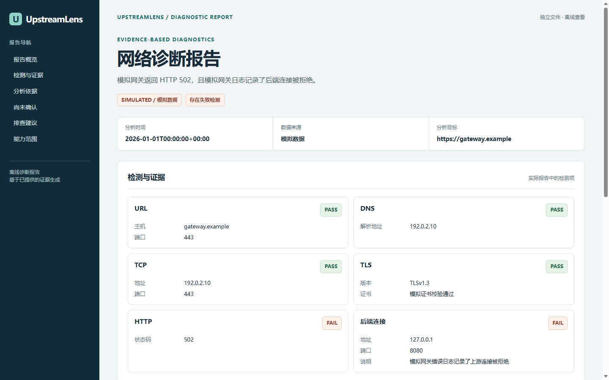

# UpstreamLens

UpstreamLens 对单个 HTTP 或 HTTPS 网址采集 DNS、TCP、TLS 和 HTTP 证据，帮助定位服务部署故障。报告区分实际观测、可能原因和需要服务端证据才能确认的信息。

[英文说明](README.md)

## 主要功能

- 对用户明确指定的单个网址检查 DNS、TCP、TLS 和 HTTP。
- 离线分析用户指定的 Nginx 错误日志，支持多份轮转文本日志。
- 输出终端、JSON 和独立离线 HTML 报告，区分观测、可能原因和待确认信息。

`502` 是响应观测。确认实际上游地址、端口或进程状态需要服务端证据。可下载[模拟报告](docs/demo.html)后在本地打开。报告和截图均使用合成数据，不是真实服务器诊断。GitHub Pages 文件已放在 `docs/`，需要仓库所有者启用后才能在线访问。



## 安装

需要 Python 3.11 或更新版本及 Git。普通用户可直接从 GitHub 仓库安装。

Windows PowerShell：

```powershell
py -3.11 -m venv .venv
.\.venv\Scripts\python.exe -m pip install "git+https://github.com/haimianbaobao1931/UpstreamLens.git"
.\.venv\Scripts\upstreamlens.exe --help
```

Linux：

```sh
python3 -m venv .venv
.venv/bin/python -m pip install "git+https://github.com/haimianbaobao1931/UpstreamLens.git"
.venv/bin/upstreamlens --help
```

开发者可先克隆仓库，创建虚拟环境，再安装可编辑包和测试依赖。

```sh
git clone https://github.com/haimianbaobao1931/UpstreamLens.git
cd UpstreamLens
python3 -m venv .venv
.venv/bin/python -m pip install -e ".[dev]"
```

Windows PowerShell 克隆后使用 `py -3.11 -m venv .venv` 和 `.\.venv\Scripts\python.exe -m pip install -e ".[dev]"`。下面的示例假定已激活虚拟环境，也可以像上面一样直接调用虚拟环境中的可执行文件。

## 使用

```powershell
upstreamlens diagnose https://example.com
upstreamlens diagnose https://example.com --timeout 3 --format json --output report.json
upstreamlens demo
upstreamlens demo --format json
upstreamlens demo --format html --output demo.html
upstreamlens diagnose https://example.com --format html --output report.html
upstreamlens analyze-nginx examples/nginx-error.log
upstreamlens analyze-nginx examples/nginx-error.log examples/nginx-error.log.1 examples/nginx-error.log.2
upstreamlens analyze-nginx examples/nginx-error.log examples/nginx-error.log.1 --format html --output nginx-report.html
upstreamlens analyze-nginx examples/nginx-error.log --host gateway.example --request-path /api/health --format json --output nginx-report.json
```

`examples/nginx-error.log` 是模拟测试数据，使用虚构域名和文档示例 IP。`analyze-nginx` 离线读取用户明确指定的本地 UTF-8 格式 Nginx 错误日志，识别上游连接拒绝、上游超时、上游提前关闭连接以及无可用上游。分析成功的退出码为 0，输入或输出错误的退出码为 2。

三个 `examples/nginx-error.log*` 文件是合成轮转日志。请按需要的顺序显式指定每个文件。多文件输出使用模式 `3.0`，包含汇总计数和 `files` 数组中的文件级计数。来源按输入顺序标为 `file-1`、`file-2` 等，证据包含来源编号与行号，不显示路径或文件名。单文件输出保留模式 `2.0` 和现有字段。记录按输入顺序处理，不按时间重新排序，也不跨文件去重，因此文件内容重叠时可能重复计数。重复输入同一文件或其路径别名会被拒绝。

工具在生成汇总报告前验证所有输入。输入失败时以位置编号指出文件，隐藏路径，也不会写出部分报告。多文件最多 20 个，合计最多 30 MiB 和 200000 行，同时保留原有单文件限制。暂不支持压缩日志或目录自动发现。

可选的主机筛选只匹配日志中的请求 `host` 字段，忽略主机名字母大小写、末尾的点及日志中附带的端口。路径筛选对去掉查询参数后的请求路径进行精确比较。缺少筛选字段的事件标为关联未确认，明确不匹配的事件单独计数。单独的 `server` 字段不能确认请求主机。故障分类数量只统计符合筛选条件的事件，有效事件总数还包含不匹配和未确认事件。

报告包含模式版本 `2.0`、计数、有数量上限的代表性证据、置信度依据、可能原因、待确认事实和建议。每条已识别的物理日志记录都会计数，完全相同的行也分别统计。记录次数不能确定独立 HTTP 请求次数。已废弃的 JSON 字段 `duplicate_lines` 保留为 `null`，表示未判定重复事件。已有的 `1.0` 报告保留原有含义，对内容相同的记录可能存在少计。请求路径、服务器名称、上游主机、认证信息、查询参数、IP 地址和原始行默认隐藏，可显示上游 HTTP 协议和端口。日志时间保留原文并标为时区未知。

输入必须是普通文件，最多 10 MiB、100000 行，每行最多 64 KiB。空文件、无效 UTF-8 和超限均报错。输出路径必须是新文件，不能指向已有输入文件。

每个网络阶段默认限时五秒。工具按指定路径和查询参数发出 HTTP GET 请求，读取响应状态和响应头。200 至 399 标为通过，400 至 599 标为失败，其余状态标为未知。重定向只记录状态，不跟随。每项检测使用 PASS、FAIL 或 UNKNOWN。目标为 IP 地址时跳过 DNS，纯 HTTP 跳过 TLS，跳过的检测标为 UNKNOWN。

使用 `--format text` 或 `--format json` 时，`--output` 另存为新的 UTF-8 JSON 文件，标准输出仍使用所选格式。HTML 报告须指定 `--format html --output PATH`，生成独立的 UTF-8 文件，不包含脚本、外部资源或联网请求，可在浏览器中离线打开。项目内的 [HTML 演示报告](examples/demo-report.html)完全使用模拟数据。已有文件会被保留。报告目标只记录协议、主机和显式指定的端口，省略路径、查询、片段、请求及响应头、原始异常。诊断有失败项时退出码为 1，参数或文件写入错误为 2，其余为 0。离线演示成功显示时返回 0。

## 限制和安全

- 仅对获授权访问的目标使用。工具直接连接指定主机及端口，只尝试该主机的解析地址。工具不扫描、不使用环境变量中的 HTTP 代理、不跟随重定向、不修改系统配置。
- 拒绝含用户名或密码的网址，请求不会附带认证头或会话凭据。查询参数会按输入发送给目标，请避免在其中包含秘密。
- HTTPS 使用标准库校验证书链和主机名。HTTP 诊断使用 HTTP/1.1。
- HTTP 502 是响应观测。确认实际后端地址、端口和进程状态需要服务端证据。
- 演示完全离线，使用模拟数据。Nginx 分析只读取用户指定的文件，当前版本暂不采集 systemd 日志，也未集成 Docker。

## 测试和打包

```powershell
.\.venv\Scripts\python.exe -m pip install -e ".[dev]"
.\.venv\Scripts\python.exe -m pytest -q
.\.venv\Scripts\python.exe -m build
```

测试使用替身和本机回环套接字。构建在 `dist/` 生成安装包和源码归档。

## 持续集成

[GitHub Actions 工作流](.github/workflows/ci.yml)在推送和拉取请求时运行。工作流进入默认分支后，也可在 Actions 页面手动运行。矩阵覆盖 Windows 和 Ubuntu，分别使用 Python 3.11 和 3.12。每组安装 `.[dev]`、运行 `pytest -q`，并检查命令行帮助和离线演示。Ubuntu 与 Python 3.12 的组合额外构建安装包和源码归档。

测试使用替身和回环套接字，无需公网诊断目标或私有配置。工作流只读取仓库内容，构建产物留在运行环境内，无上传或发布步骤。

已在 Windows 11、PowerShell 7.6 和 Python 3.11.4 上完成本地验证。GitHub Actions 已通过 Windows 和 Ubuntu 上的 Python 3.11、3.12 四组测试，以及 Ubuntu Python 3.12 的分发包构建。
